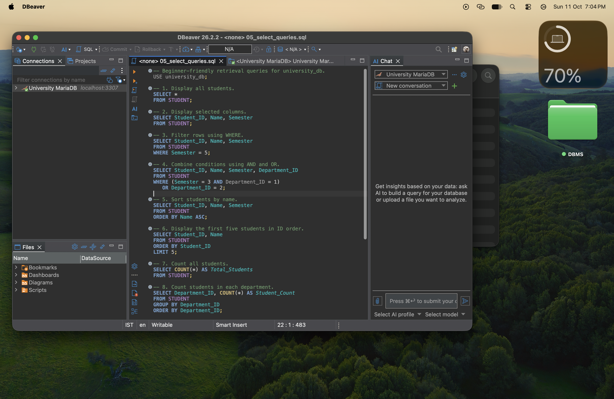

# Experiment 03 — SQL Query Sandbox

## Aim

To construct a university database from an ER model and execute basic DDL and DML commands for managing its records.

## Software required

- MariaDB Server
- DBeaver Community or a later edition with MariaDB support

## Theory

Data Definition Language (DDL) commands define database structures. Examples include `CREATE`, `ALTER`, `RENAME`, `TRUNCATE`, and `DROP`.

Data Manipulation Language (DML) commands work with records stored in tables. This experiment uses `INSERT`, `UPDATE`, `DELETE`, and `SELECT`.

## Database tables and relationships

The database is named `university_db` and contains five tables:

- DEPARTMENT stores the four university departments.
- STUDENT belongs to one department.
- FACULTY belongs to one department.
- COURSE belongs to one department and is taught by one faculty member.
- ENROLLMENT connects students and courses. It resolves their many-to-many relationship.

Foreign keys enforce these relationships. The sample data contains 4 departments, 12 students, 6 faculty members, 8 courses, and 20 enrollments.

## SQL commands demonstrated

- DDL: `CREATE DATABASE`, `CREATE TABLE`, `ALTER TABLE`, `RENAME TABLE`, `TRUNCATE TABLE`, and `DROP TABLE`
- DML: `INSERT`, `UPDATE`, `DELETE`, and `SELECT`
- Retrieval: `WHERE`, `AND`, `OR`, `ORDER BY`, `LIMIT`, `COUNT`, `GROUP BY`, and `INNER JOIN`

Destructive DDL commands operate only on `LAB_DEMO`, a temporary demonstration table. The five university tables are not removed by the demonstration file.

## Steps to execute in DBeaver

1. Start the MariaDB server.
2. In DBeaver, select **Database > New Database Connection** and choose **MariaDB**.
3. Enter the host (normally `localhost`), port, username, and password. MariaDB normally uses port `3306`; this verified local setup uses `3307` because another database server already occupies `3306`. Test and finish the connection.
4. Open each `.sql` file with **File > Open File**, or right-click the MariaDB connection and choose **SQL Editor > Open SQL Script**.
5. Execute the complete files in this order:
   1. `01_create_database.sql`
   2. `02_insert_data.sql`
   3. `03_ddl_commands.sql`
   4. `04_dml_commands.sql`
   5. `05_select_queries.sql`
6. Refresh the connection, expand `university_db`, and open **Tables** to view the five tables.
7. Right-click a table and choose **View Data** to check its records. The SELECT results also appear in DBeaver's results panel.

Use **Execute SQL Script** when running a complete file. MariaDB may require a user with permission to create databases. The scripts use MariaDB syntax and should be run on a MariaDB connection rather than another database product.

### Faculty demonstration interface

Create a virtual environment and install the small Flask interface dependencies:

```bash
python3 -m venv .venv
source .venv/bin/activate
python -m pip install -r requirements.txt
```

Set the MariaDB connection values in the terminal and start the explorer:

```bash
export DB_HOST=127.0.0.1
export DB_PORT=3307
export DB_NAME=university_db
export DB_USER=dbms_lab
export DB_PASSWORD='your-local-password'
python app.py
```

On Windows PowerShell, use `$env:DB_USER="dbms_lab"` and the same form for the other variables. Open `http://127.0.0.1:5003`. For a faculty demonstration, select each table to show its live records, choose a numbered SELECT example, review the displayed SQL, and select **Run query**. The interface accepts only the predefined read-only queries from `05_select_queries.sql`.

## Expected observations

After the first two scripts complete successfully, the expected row counts are:

| Table | Expected rows |
|---|---:|
| DEPARTMENT | 4 |
| STUDENT | 12 |
| FACULTY | 6 |
| COURSE | 8 |
| ENROLLMENT | 20 |

The DDL demonstration creates, changes, renames, empties, and removes only a temporary table. The DML demonstration adds student `1099`, changes that student's semester, displays the record, and deletes it. STUDENT therefore returns to 12 rows. The SELECT queries demonstrate filtering, sorting, counting, grouping, and joins.

For submission screenshots, capture DBeaver only after executing the scripts. Useful screenshots include the five tables in the Database Navigator, the expected row counts, the DML result, and the three-table join result. Do not use fabricated screenshots.

### Verified DBeaver connection



## Result / conclusion

The experiment shows how a university ER model is converted into related MariaDB tables. Primary and foreign keys maintain valid relationships, while basic DDL and DML commands define structures and manage records.

> Verification note: The complete script sequence was executed successfully using MariaDB 13.0.2. The final counts were 4 departments, 12 students, 6 faculty members, 8 courses, and 20 enrollments. A validation query found zero invalid enrollment foreign-key references. DBeaver Community 26.2.2 was connected to this MariaDB instance and the connection was captured in the screenshot above.
