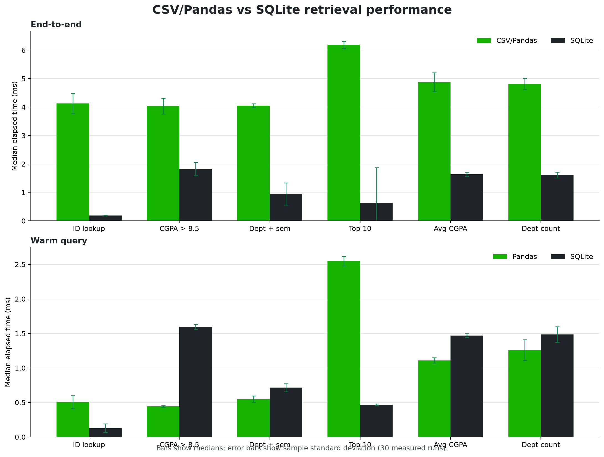
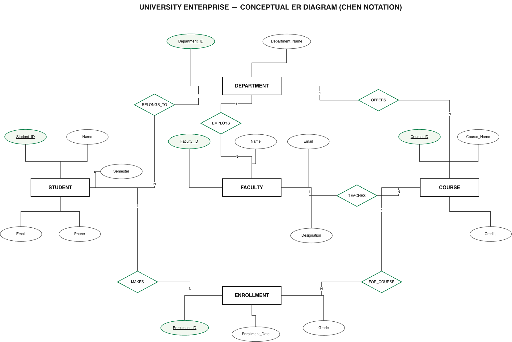
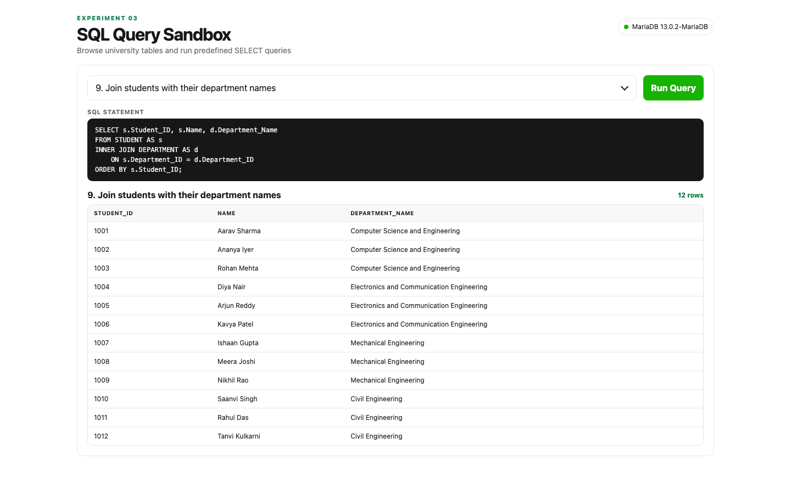
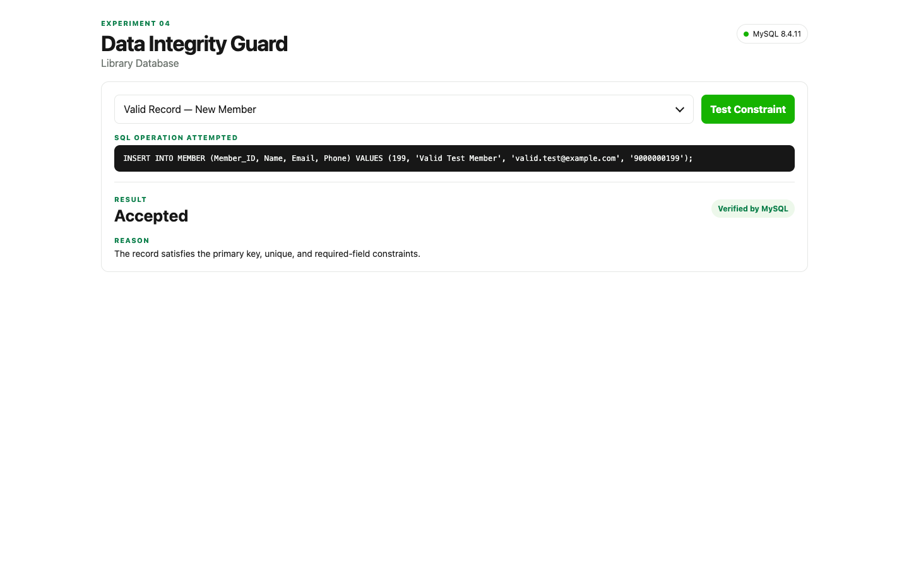
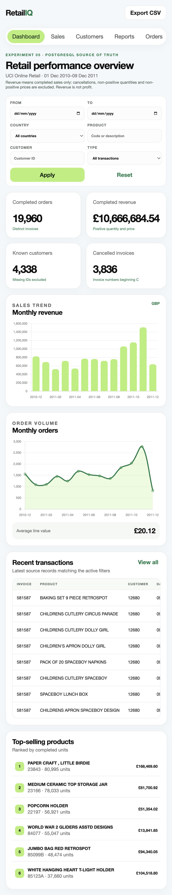

<div align="center">
  <a href="https://github.com/Tirth-byte/DBMS-EX">
    
  </a>
  <br>
  <a href="https://github.com/Tirth-byte/DBMS-EX">
    
  </a>
</div>

<br>

<p align="center">
  A complete DBMS laboratory portfolio built around practical database design,
  SQL, integrity constraints, analytics, and normalization.
</p>

## Project overview

This repository contains six progressively structured database experiments. Each
experiment combines academic concepts with executable SQL, application code,
diagrams, reports, and evidence screenshots.

The project demonstrates how data moves from a simple relational model to
constraint-aware systems, analytical dashboards, and a normalized hospital
database design.

## Experiments

| No. | Experiment | Main technology | Core concept | Open |
|---:|---|---|---|---|
| 01 | Logic Auditor | Python, SQLite, Flask | Query performance and indexing | [Open experiment](./01_Logic_Auditor/) |
| 02 | Campus ER Modeler | Draw.io | Chen ER modeling and relationships | [Open experiment](./02_Campus_ER_Modeler/) |
| 03 | SQL Query Sandbox | MariaDB, Flask | DDL, DML, SELECT, JOIN, and GROUP BY | [Open experiment](./03_SQL_Query_Sandbox/) |
| 04 | Data Integrity Guard | MariaDB, Flask | Primary, unique, foreign-key, and check constraints | [Open experiment](./04_Data_Integrity_Guard/) |
| 05 | Business Insights Engine | PostgreSQL, Flask, Chart.js | Real retail analytics and SQL reporting | [Open experiment](./05_Business_Insights_Engine/) |
| 06 | The Redundancy Refactor | Flask, CSV, SQL | UNF to 1NF, 2NF, 3NF, and BCNF | [Open experiment](./06_Redundancy_Refactor/) |

## Interactive applications

### Experiment 1 - Logic Auditor

Benchmarks database access patterns and compares indexed and non-indexed
queries using a generated student dataset.



### Experiment 2 - Campus ER Modeler

Contains an editable Chen notation ER diagram for a campus database model.



### Experiment 3 - SQL Query Sandbox

Provides executable SQL scripts and a Flask interface for exploring database
creation, inserts, updates, filtering, joins, and grouped queries.



### Experiment 4 - Data Integrity Guard

Demonstrates how relational constraints prevent invalid data and protect
referential integrity.



### Experiment 5 - Business Insights Engine

A PostgreSQL-backed retail analytics dashboard using the UCI Online Retail
dataset. Metrics, charts, reports, filters, and order results are backed by
database queries rather than fabricated values.



### Experiment 6 - The Redundancy Refactor

An interactive normalization laboratory for a hospital dataset. It exposes
redundancy and anomalies, then walks through UNF, 1NF, 2NF, 3NF, and BCNF before
showing the final relational schema.


## Technology stack

- Python and Flask
- SQLite
- MariaDB
- PostgreSQL
- HTML, CSS, and vanilla JavaScript
- Chart.js
- CSV and SQL
- Draw.io
- pgAdmin 4 and LibreOffice Base-compatible workflows

## Running the experiments

Each application is intentionally self-contained. Open the experiment folder
and follow its local README for database setup and launch details.

### Python applications

```bash
cd 01_Logic_Auditor
python3 -m venv .venv
source .venv/bin/activate
pip install -r requirements.txt
python app.py
```

The same Flask pattern applies to Experiments 3, 4, 5, and 6. Use each
experiment's README for its port, environment variables, and database setup.

### Database-backed experiments

Experiments 3 and 4 require a local MariaDB-compatible server. Experiment 5
requires PostgreSQL and the `retail_db` database. Use placeholder values in
your shell environment:

```bash
export DB_HOST=127.0.0.1
export DB_PORT=3306
export DB_USER=your_local_user
export DB_PASSWORD=your_local_password
```

For the retail dashboard:

```bash
export PGHOST=127.0.0.1
export PGPORT=5432
export PGDATABASE=retail_db
export PGUSER=your_local_user
export PGPASSWORD=your_local_password
```

Never commit real credentials. Experiment 5 includes the import script and
database definition; the large raw workbook is intentionally excluded from
version control. Download the UCI Online Retail dataset from the official
source and place it at `05_Business_Insights_Engine/data/Online Retail.xlsx`
before running the importer.

### Experiment 2 and database files

Experiment 2 can be opened directly in Draw.io. The SQL scripts in Experiments
3 and 4 can be executed through MariaDB tools such as DBeaver or the MariaDB
client. Experiment 6 includes the normalization CSV files, SQL deliverables,
report, and editable Draw.io schema.

## Repository structure

```text
DBMS/
├── 01_Logic_Auditor/
├── 02_Campus_ER_Modeler/
├── 03_SQL_Query_Sandbox/
├── 04_Data_Integrity_Guard/
├── 05_Business_Insights_Engine/
├── 06_Redundancy_Refactor/
├── .gitignore
└── README.md
```

Each experiment keeps its own source code, SQL, documentation, diagrams,
datasets, and screenshots. The root repository does not alter the internal
experiment structure.

## Learning outcomes

After completing the laboratory, a learner can:

- design entities and relationships using ER modeling
- create and manipulate relational tables with SQL
- use JOIN, GROUP BY, HAVING, and aggregate functions
- enforce data integrity with relational constraints
- compare indexed and non-indexed access patterns
- build a real database-backed analytical interface
- identify insertion, update, and deletion anomalies
- derive functional dependencies and normalize a relation
- evaluate lossless decomposition, dependency preservation, and BCNF

## Author

**Tirth Patel**

- GitHub: [Tirth-byte](https://github.com/Tirth-byte)
- Repository: [DBMS-EX](https://github.com/Tirth-byte/DBMS-EX)

## License

No license has been selected for this academic laboratory repository. All
existing project files remain available for educational review.

